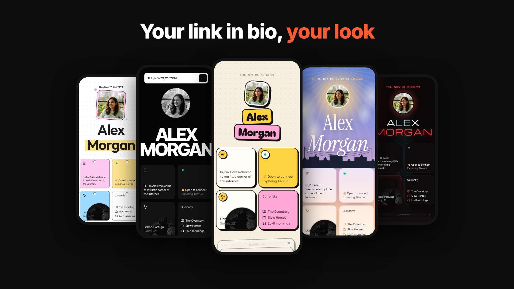
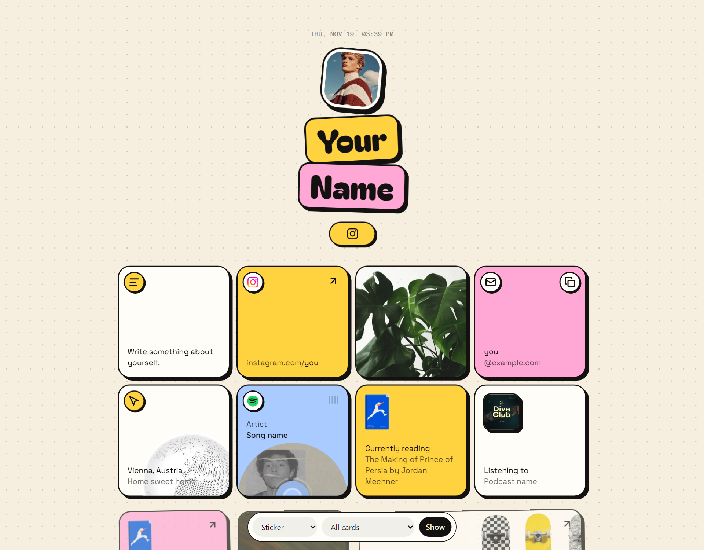

<p align="center">
  <a href="https://tilevue.com">
    <picture>
      <source media="(prefers-color-scheme: dark)" srcset=".github/assets/tilevue-logo-white.svg">
      
    </picture>
  </a>
</p>

<h1 align="center">Looks and cards</h1>

<p align="center">
  The page themes and cards behind <a href="https://tilevue.com">Tilevue</a>, the free link in bio page made of cards.
</p>

<p align="center">
  <a href="https://tilevue.com"><b>tilevue.com</b></a> ·
  <a href="https://tilevue.com/looks">All looks</a> ·
  <a href="https://www.instagram.com/tilevuecom/">Instagram</a> ·
  <a href="https://x.com/tilevuecom">X</a> ·
  <a href="https://www.youtube.com/@tilevue">YouTube</a>
</p>

<p align="center">
  
</p>

This repo has all **34 looks** (page themes) and all **87 card types**, as the real Next.js + React + Tailwind code
that runs on tilevue.com. Make a new look or a new card here, and once it's merged it ships on tilevue.com for
everyone.

<p align="center">
  
  <br><sub>The playground: every card type, in the look you pick.</sub>
</p>

## Run it

```bash
git clone https://github.com/Tilevue/tilevue-design.git
cd tilevue-design
npm install
npm run dev
```

Open [localhost:3000](http://localhost:3000). It's a sample page with **every card type**, in the look you pick in
the bar at the bottom. `?look=noir` picks a look and `?card=poll` shows one card type only. Edit a file and the page
updates.

## What's where

```
looks/                 the page themes: one CSS file per look
  README.md            the hooks a look may use: read this first
  registry.ts          the list of looks (id, label, description, tags)
components/cards/      one component per card type
  README.md            how cards are built: read this first
  registry.ts          card type → component
components/Card.tsx    the building blocks every card uses (Card, CardTop, CardIcon, Arrow)
lib/cardSchema.ts      each card's fields, size and sample values (the playground shows these)
app/globals.css        the colour tokens (light, dark) the cards and looks use
app/page.tsx           the playground page
```

## Make a new look

1. Copy a look that's close, e.g. `looks/notebook.css` → `looks/yourlook.css`, and rename
   `[data-look="notebook"]` to `[data-look="yourlook"]` throughout.
2. Add it to `LOOKS` in `looks/registry.ts` and import it in `looks/all.css`.
3. Style it through the hooks in [looks/README.md](looks/README.md). Check it with all cards, and on a phone-sized
   window.

## Make a new card

1. Add the component in `components/cards/`, built from `components/Card.tsx`.
2. Register it in `components/cards/registry.ts`.
3. Describe its fields, size and sample values in `lib/cardSchema.ts`.

All three, in that order. See [components/cards/README.md](components/cards/README.md). Then check it in a few looks:
`?card=yourcard&look=sticker`.

## What's here and what isn't

This repo is the design layer only. Accounts, saving, the editor and the API are not open source. A few files are
small stand-ins for those parts, so the cards run on their own:

- `app/interact.ts`: poll votes, reactions and guestbook notes answer as if they worked, but nothing is saved.
- `lib/store.ts`, `lib/profile.ts`: types only.
- `lib/posts.ts`: no blog posts, so the post card shows its empty state.
- `content/site.ts`: the few site settings the cards read.

Sample photos load from tilevue.com (see `next.config.ts`). They aren't part of this repo or its license.

## License

The code is [MIT](LICENSE).

- **The Tilevue name and logo are not covered by the license.** Please don't use them for your own product. The
  logo files and images in `.github/assets` are here for this README and for linking to Tilevue.
- Brand icons in `public/icons` belong to their owners and are for linking to those services.
- Fonts come from Google Fonts under their own open licenses.

See [CONTRIBUTING.md](CONTRIBUTING.md) before opening a pull request.
